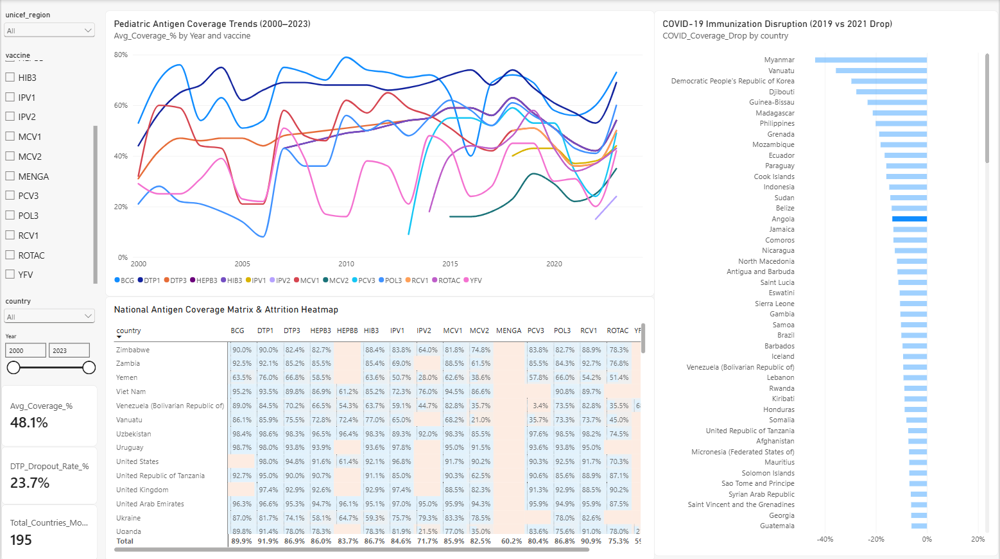

# Pediatric Immunization Surveillance & Dropout Analytics

A Power BI dashboard that tracks childhood vaccine coverage, DTP1 to DTP3 dropout, and the COVID-19 disruption to routine immunization across 195 countries and 16 antigens, using WHO/UNICEF Estimates of National Immunization Coverage (WUENIC), 2000 to 2023.



## At a glance

| | |
|---|---|
| Countries | 195 (7 UNICEF programme regions + "Non-programme") |
| Antigens | 16 (BCG, DTP1, DTP3, HepB3, HepB birth dose, Hib3, IPV1, IPV2, MCV1, MCV2, MenA, PCV3, Pol3, RCV1, RotaC, YFV) |
| Years | 2000 to 2023 |
| Fact rows | 58,080 country-antigen-year cells (44,054 with a reported estimate) |
| Tooling | Python (ETL, see `notebooks/`), Power BI Desktop, DAX |

## Repository structure

```
pediatric-immunization-surveillance/
├── Pediatric_Immunization_Surveillance.pbix   Power BI report + data model
├── assets/
│   └── dashboard_preview.png                  Dashboard screenshot
├── data/
│   ├── Fact_VaccineCoverage.csv               Long-format coverage estimates
│   ├── Dim_Country.csv                        Country and UNICEF region
│   └── Dim_Vaccine.csv                        Antigen type and target disease
└── notebooks/
    └── wuenic_etl_pipeline.ipynb              Cleaning and star-schema export
```

## Data model

Star schema with one fact table and three dimensions. All relationships are many-to-one, single-direction.

```
 Dim_Country  (iso3)    1 ──┐
                            │
 Dim_Vaccine  (vaccine) 1 ──┼──* Fact_VaccineCoverage
                            │    (iso3, vaccine, year, coverage_pct)
 Dim_Calendar (Year)    1 ──┘
```

* `Fact_VaccineCoverage`: one row per country, antigen and year; `coverage_pct` is the WUENIC estimate (0 to 99).
* `Dim_Country`: `iso3`, `country`, `unicef_region`.
* `Dim_Vaccine`: `vaccine`, `antigen_type` (bacterial / viral), `target_disease`.
* `Dim_Calendar`: DAX calculated table, `GENERATESERIES(2000, 2023, 1)`.
* `_Measures`: dedicated measure table.

## DAX measures

**Average coverage** (unweighted mean of country-antigen-year estimates)

```dax
Avg_Coverage_% =
DIVIDE(
    SUM(Fact_VaccineCoverage[coverage_pct]),
    COUNT(Fact_VaccineCoverage[coverage_pct]),
    0
) / 100
```

**DTP dropout rate** (share of children starting DTP who do not complete the third dose)

```dax
DTP_Dropout_Rate_% =
VAR DTP1_Cov = CALCULATE([Avg_Coverage_%], Dim_Vaccine[vaccine] = "DTP1")
VAR DTP3_Cov = CALCULATE([Avg_Coverage_%], Dim_Vaccine[vaccine] = "DTP3")
RETURN
    IF(
        NOT ISBLANK(DTP1_Cov) && NOT ISBLANK(DTP3_Cov) && DTP1_Cov > 0,
        DIVIDE(DTP1_Cov - DTP3_Cov, DTP1_Cov, 0),
        BLANK()
    )
```

**COVID-19 coverage drop** (2021 minus 2019, in percentage points)

```dax
COVID_Coverage_Drop =
VAR Cov2019 = CALCULATE([Avg_Coverage_%], Dim_Calendar[Year] = 2019)
VAR Cov2021 = CALCULATE([Avg_Coverage_%], Dim_Calendar[Year] = 2021)
RETURN
    Cov2021 - Cov2019
```

**Low-coverage conditional formatting** (flags cells below the 80% threshold)

```dax
Low_Coverage_Alert_Color =
IF([Avg_Coverage_%] < 0.80, "#D9381E", "#1E88E5")
```

## Key findings

All figures computed from the data in `data/`, with no slicer selections.

1. **Global dropout is modest; country dropout is not.** Across all countries and years, mean DTP1 coverage is 91.9% and DTP3 is 86.9%, a 5.5% dropout. Individual countries are far higher: Angola's 2000 to 2023 dropout is 23.7%, which points to retention after first contact, not access, as the bottleneck there.
2. **COVID-19 hit fragile systems hardest.** Comparing the same antigens in 2019 and 2021, 128 of 195 countries lost coverage (mean -3.1 percentage points). The largest falls were Myanmar (-43 pp), DPR Korea (-33 pp), Djibouti (-28 pp), Vanuatu (-26 pp) and Guinea-Bissau (-21 pp).
3. **Newer vaccines scaled fast.** PCV3 went from 45 reporting countries in 2010 to 158 in 2023, and rotavirus from 26 to 124, with mean coverage among adopters around 80%. Lower averages for MenA and yellow fever reflect that they are given only in endemic countries (15 and 37 countries in 2023), not poor performance.

## Limitations

* Averages are unweighted: a small island state counts the same as India. Population-weighted coverage would need WUENIC target-population counts.
* `COVID_Coverage_Drop` averages whatever antigens a country reports in each year, so introducing a new vaccine in 2020 or 2021 can shift the figure. The like-for-like numbers in finding 2 control for that.
* WUENIC values are modelled estimates capped at 99%, not raw administrative data.

## How to open

1. Clone the repository:
   ```bash
   git clone https://github.com/wahida-binte/pediatric-immunization-surveillance.git
   ```
2. Open `Pediatric_Immunization_Surveillance.pbix` in Power BI Desktop. The report opens with its data already loaded.
3. To refresh from the CSVs, go to **Transform data > Data source settings > Change Source** and point each query to the matching file in `data/`.

## Data source

WHO/UNICEF Estimates of National Immunization Coverage (WUENIC). Data are reproduced for non-commercial analysis; see the [WHO immunization data portal](https://immunizationdata.who.int/) for terms and the latest revision.

## Author

**Faiza Binte Zaman**
